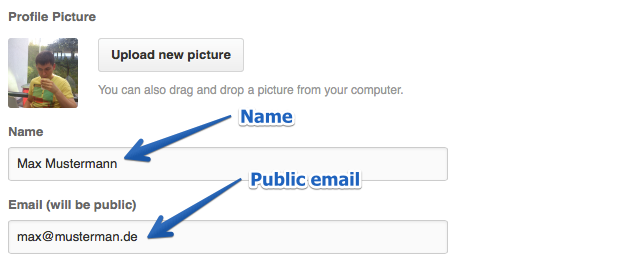

# 101companies-wiki

 

101wiki web app written using Ruby on Rails.

## Software dependencies

Versions are pinned in `.tool-versions` and are picked up by [mise](https://mise.jdx.dev):

* Ruby 4.0.9
* Node 22 (only needed to build the JavaScript/CSS bundles)
* PostgreSQL (with `libpq-dev` and `build-essential` to compile the native gems)

On Ubuntu:

    apt-get install libpq-dev postgresql postgresql-client build-essential

## Ruby

Install the pinned Ruby and Node with mise:

    mise install

## Installing the app

Install the Ruby and JavaScript dependencies:

    bundle install
    npm install

You need a postgres dump which must be acquired from the 101companies admins.
If you have a dump load it like this:

    cat wiki_db.gz | gunzip | psql wiki_development

After setting up the database you need to start it and then launch application with:

    bin/dev          # builds the JS/CSS bundles in watch mode + starts the server

or, without asset watching:

    npm run build
    bin/rails s

JavaScript and CSS are bundled by [esbuild](https://esbuild.github.io) into
`app/assets/builds` and served by [Propshaft](https://github.com/rails/propshaft).
`app/javascript/application.js` and `app/javascript/styles/application.css` are
the two entry points; React components are registered in
`app/javascript/components/index.js` and mounted from `react_component` calls in
views.

## Admin rights

To be signed in you need to have GitHub account with **name** and **public email** in GitHub profile.

If you have been successfully signed in, you can set another role to your user:

    bundle exec rake change_role

You will be asked for your email and new role. Just type email from your GitHub account and role **admin**.

## Keys

You need some keys of 101companies before you can start to work.
You can ask [@avaranovich](https://github.com/avaranovich), [@rlaemmel](https://github.com/rlaemmel) or
[@tschmorleiz](https://github.com/tschmorleiz) for this password.

For successful work with project in development mode you need to define next ENV variables in your .bashrc/.zshrc, for deployment, place them inside /etc/environment.

    export SLIDESHARE_API_KEY=
    export SLIDESHARE_API_SECRET=
    export GMAIL_PASSWORD=
    export GITHUB_KEY_DEV=
    export GITHUB_SECRET_DEV=
    export MONGODB_USER=
    export MONGODB_PWD=

## Upgrade history (6.1 -> 8.1, Ruby 3.0 -> 4.0)

The app was upgraded one Rails minor at a time, with a green test suite at every
step:

| Step | Rails | Ruby | Notes |
| --- | --- | --- | --- |
| 1 | 6.1.7.10 | 3.0.3 | baseline; `require 'logger'` in `config/boot.rb` (concurrent-ruby >= 1.3.5), `json` pinned < 3 |
| 2 | 7.0.10 | 3.0.3 | `config.load_defaults 7.0` (this also enabled Zeitwerk), `sprockets-rails` added back |
| 3 | 7.1.6 | 3.0.3 | `config/secrets.yml` removed (production reads `SECRET_KEY_BASE`) |
| 4 | 7.2.3 | 3.3.10 | Rack 3 |
| 5 | 7.2.3 | 3.3.10 | Webpacker + react-rails replaced by esbuild + Propshaft + jsbundling-rails |
| 6 | 8.0.5.2 | 3.4.12 | `config.load_defaults 8.0` |
| 7 | 8.1.4.1 | 4.0.9 | `json` pin dropped (Rails 8.1 no longer uses `quirks_mode`), ViewComponent 4 |

Dropped along the way: `webpacker`, `react-rails`, `sprockets-rails`, `mina`,
`rails-erd`, `hightop`, `flamegraph`, `stackprof`, `memory_profiler`,
`turbolinks`, and `config/deploy.rb`.

## Contributing

If you make improvements to this application, please share with others.

*   Fork the project on GitHub.
*   Make your feature addition or bug fix.
*   Commit with Git.
*   Send a pull request.

If you add functionality to this application, create an alternative implementation, or build an application that is similar, please contact me and I’ll add a note to the README so that others can find your work.
